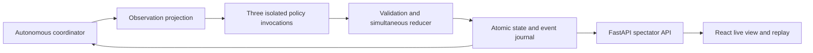

# Multi Agent Maze Exploration Technical Specification

**Status:** Implementation specification, version 1.0  
**Date:** 17 October 2026  
**Target:** Python simulation and experiment runner, FastAPI spectator service, React spectator UI

## 1. Purpose and architectural decision

Build a reproducible experiment in which three autonomous agents explore a maze, find its exit, and decide how to use limited memory and communication. Each agent makes one fresh LLM invocation per decision turn. It receives current local observations, immediate feedback from its previous action, its own notebook, one ephemeral radio inbox, and notebooks belonging to agents currently sharing its cell. It receives no conversation history or prebuilt map.

Use **Pydantic models as the canonical contracts, a framework-independent Python simulation core, and PydanticAI as the first LLM adapter**. Add a LangChain adapter for community contributions without changing simulation semantics. Use a small explicit tick coordinator rather than an agent framework to own time, simultaneous movement, budgets, or persistence. Recommend React with TypeScript for the viewer.

Python to use 3.14 version. UV as package manager. Keep all code ruff and pylance/pydantic compliant.

LLM / API choice to be abstracted - I would like to try different models local and hosted. Maybe even different models per agent to mix it up. So either OpenAPI-compatible (OAI or Ollama) or Anthropic compatible.

The experiment measures navigation, memory management, coordination, and reliability under controlled information constraints. The spectator has complete ground truth; agents do not. Keeping these two interfaces separate is a correctness requirement.

“MUST” denotes a required behavior. “Default” denotes a concrete implementation choice that may be changed by a versioned experiment configuration. The numerical budgets, maze dimensions, and operating defaults below are proposed defaults, not previously agreed measurements.

## 2. Requirements and non-goals

The first release MUST provide:

- Exactly three identifiable agents, `A`, `B`, and `C`, each with independent decisions and private persistent notes.
- An autonomous clock that advances without spectator requests or an open browser.
- Simultaneous resolution of at most one compass move, one notebook mutation, and one radio transmission per agent per tick. These actions may be combined.
- Optional deliberate staying still, including a complete no-op.
- Current-cell perceptions, four compass edge descriptions, distance to the exit, and distances to the other two agents.
- A bounded notebook whose contents and compaction are managed by its owner.
- Rate-limited radio that is ephemeral for agents and fully archived for spectators.
- Full read-only peer notebook access during physical co-location, with no automatic merge.
- Spectator REST and streaming APIs for the maze, agent state, notes, radio, timeline, metrics, and replay.
- Deterministic environment generation and action-based replay, plus algorithmic baselines.

Version 1 excludes physical orientation, continuous movement, combat, inventory, moving walls, agent-created physical markings, voice chat, and an agent-accessible browser or filesystem. Unity is a possible future viewer, not a simulation dependency. The UI MUST NOT silently inject hints or edit agents' notebooks.

## 3. Reference configuration

| Setting | Default | Meaning |
| --- | --- | --- |
| Agent count | 3 | IDs A, B, C; identity persists throughout a run |
| Maze | 15 × 15 cells | Four-neighbor rectangular grid with edge walls |
| Generation | Seeded randomized depth-first spanning tree | Connected perfect maze; looped mazes are a separate condition |
| Exit | One uniformly selected perimeter cell | Reaching the marked cell counts as reaching the exit |
| Spawn | Three distinct non-exit cells, sampled uniformly | All reachable; no forced distance balancing in the default |
| Clock | `fixed_deadline` | 30,000 ms decision window; wall clock advances autonomously |
| Run horizon | 500 ticks | Stop after resolving tick 500 |
| Objective | `all_reach_exit` | Each agent must visit the exit at least once |
| Movement | N, E, S, W, STAY | One cell per tick; STAY enabled |
| Notebook cap | 8,192 UTF-8 bytes per agent | Full current notebook supplied each invocation |
| Notebook write budget | 1,024 inserted UTF-8 bytes per tick | One contiguous splice; deletions do not consume inserted bytes |
| Radio budget | 280 UTF-8 bytes per transmission | One nonempty broadcast when eligible |
| Radio cooldown | 5 intervening ticks | Send at 10; next eligible at 16 |
| Radio visibility | One following decision observation | Sent at t, present only in observation for t+1 |
| Distances | Euclidean, nearest 0.1 cell | No bearing and no shortest-path distance |
| Landmarks / checkpoints | Off / off | Controlled experimental variants |
| LLM output limit | 2,048 provider output tokens | Record provider accounting, including reasoning if applicable |
| LLM requests | 1 per agent per tick | No model-based repair or automatic second request |
| Snapshot interval | Every 25 committed ticks | Also initial and terminal snapshots |
| Storage | SQLite WAL, one coordinator | PostgreSQL supported when scaling |
| Stream | SSE initially; equivalent WebSocket endpoint | Both carry the same versioned event envelopes |

All configuration is immutable after creation, except explicit pause/resume controls. To change an experiment, create a new run or a recorded fork. A response timeout produces a forced no-op and does not pause other agents.

## 4. World geometry and information boundaries

### 4.1 Ground truth

The engine stores integer cells `(x, y)`, with east increasing x and south increasing y. North is `(0, -1)`. A wall lives on an edge between adjacent cells, not in an occupied tile. Reciprocal edges MUST agree: if `(x, y).east` is open, `(x+1, y).west` is open.

Every edge leading outside the rectangle is closed and described as `outer_brick`. Every closed edge between two in-bounds cells is `interior_wall`. **Brick appears only on the outer boundary.** An interior wall must never be labelled brick, and a boundary-adjacent cell can still have ordinary interior walls on its other sides.

The default exit is a marked cell just inside the boundary. Reaching it is sufficient; no movement through the boundary is required. This avoids an exception to the sealed outer wall rule. A future exit-gate variant must explicitly define its geometry and success action.

Ground truth includes maze dimensions, all edges, spawn coordinates, exit coordinates, landmark placement, agent coordinates, traversal history, and optimal routes. These are available to the spectator and scorer only.

### 4.2 What an agent observes

Each observation contains only:

1. Stable identity, decision tick, public rules and budgets, and whether this agent has previously reached the exit.
2. Feedback from the immediately preceding tick, including attempted direction, movement result, arrival side, and notebook/radio acceptance or rejection.
3. The four edges at its current cell: `open`, `interior_wall`, or `outer_brick`.
4. Whether this cell is the exit; locally visible landmark/checkpoint labels when enabled.
5. Straight-line distance to the exit and each named peer, computed from the same committed state.
6. Its entire current notebook and revision.
7. Radio transmissions sent during the preceding tick, visible for this decision only.
8. The full current notebooks of physically co-located peers, identified by owner and revision.

The observation MUST NOT contain world coordinates, cell IDs, map width/height, generator name/seed, paths, bearings to targets, visited-cell counts, remote landmarks, hidden teammate state, notebook history, previous prompts, or historical radio. Spectator metrics and tracing metadata must never enter the prompt.

The agent can infer a private coordinate system by choosing its own origin, integrating successful compass moves, and recording results. It can infer spatial constraints from distances, boundary materials, and meetings. Such inference is part of the experiment. “Hidden coordinates” prohibits direct disclosure; it does not promise that coordinates are impossible to infer. No framework creates, normalizes, corrects, or aligns an agent's map for it.

### 4.3 Distances

For cells p and q, distance is `sqrt((p.x-q.x)^2 + (p.y-q.y)^2)` in cell units, ignoring walls. Report an integer `distance_tenths`, rounded to nearest tenth, with halves rounded upward. Use integer square-root comparisons to implement rounding consistently across runtimes; do not expose floating-point artifacts.

Specifically, let `n = dx*dx + dy*dy`, `q = isqrt(100*n)`, and return `q + int(400*n >= (2*q + 1)**2)`. This uses exact integer arithmetic.

All distances use the observation's state tick. Co-location gives zero. The two peer readings are ordered A/B/C, excluding self, and include agents that have already visited the exit because those agents remain in the world. No distance trend or previous value is automatically supplied. Distances are informational sensors, not pathfinding hints generated by the engine.

### 4.4 Landmarks and checkpoints

Landmarks are optional static labels visible only on the current cell. Default labels are unique, randomly assigned symbols without coordinate or ordering information. Repeated-label ambiguity is a separately named variant. Placement is independent of hidden route quality unless the experiment explicitly tests route clues.

Checkpoints add an optional task condition. Default checkpoint variant requires every agent to visit every checkpoint and then the exit; public rules list the required checkpoint labels, but not their positions. Agents maintain their own progress notes. The scorer stores objective progress privately and reveals only the configured success receipt. Checkpoints do not save, teleport, reset, or automatically annotate a notebook.

## 5. Turn semantics

### 5.1 Indexing and timing

`S_0` is the initial committed state. Tick/decision turn `t`, starting at 1, consumes observation `O_t = observe(S_(t-1))` and produces `S_t`. Feedback about movement at tick t becomes available immediately when `S_t` commits and is included in `O_(t+1)`.

“Immediate” means no extra simulation tick of delay after resolution. It does not mean a second LLM invocation after moving. An agent plans its move, notebook edit, and radio from the same pre-movement observation. It cannot inspect its destination and write about it during the same decision. At the next invocation it can record the new local perception and previous movement feedback.

Example: A attempts east on tick 10. If successful, its receipt says `attempted=E`, `outcome=moved`, `arrived_from=W`. `O_11` contains that receipt and the new cell's edges. No automatic notebook entry is added. If blocked, `arrived_from=null`; the engine must not invent an arrival or repeat an older arrival side. Initial observation uses `outcome=spawned`.

### 5.2 Simultaneous movement

Each action is validated against `S_(t-1)`. Compute every destination before changing any position, then commit all destinations together.

- Open edge: move one cell.
- Closed edge: remain in place, outcome `blocked`.
- STAY: remain in place, outcome `stayed`.
- Missing, invalid, late, or failed decision: remain in place, outcome `forced_stay` and a machine-readable cause.
- Multiple agents may occupy one cell. Occupancy never blocks movement.
- Two agents swapping adjacent cells do not meet.
- Agents passing conceptually along the same edge do not meet.
- An agent moving into a cell occupied by a staying agent does meet that agent.
- Three agents ending on the same cell all meet each other.

Do not resolve in response-arrival order or agent-ID order. ID order is only for stable serialization and event ordering.

### 5.3 Meetings and notebook visibility

Meeting groups are sets of at least two agents whose **end-of-tick positions match**. After applying valid notebook edits and movement, compute groups from `S_t`. `O_(t+1)` includes each group member's complete notebook from `S_t`. The books are read-only snapshots.

If agents remain together, each subsequent observation includes updated books. If they separate during tick t+1, they still acted on the books seen in `O_(t+1)`, but those books disappear from `O_(t+2)`. Keeping any information requires an explicit own-notebook write, subject to the usual budget. Reading does not copy, merge, synchronize, or change coordinate conventions. There is no free co-location chat channel in the default condition.

Initial co-location, when explicitly configured, is observed at `S_0`. A terminal tick records meetings even when no next LLM invocation is made.

### 5.4 Notebook operations and budgets

The notebook is plain UTF-8 text. It begins empty. Agents may write prose, tables, coordinates, JSON, or another notation. The engine does not interpret content for navigation.

One optional mutation is a contiguous splice:

```text
new_text = old_text[:start] + inserted_text + old_text[end:]
```

`start` and `end` are zero-based Unicode code-point offsets with a half-open interval; they are not UTF-8 byte or JavaScript UTF-16 offsets. Require `0 <= start <= end <= len(old_text)`. The mutation references the notebook revision supplied in the observation.

| Operation | Splice |
| --- | --- |
| Append | start=end=current code-point length |
| Replace whole notebook | start=0, end=current length |
| Delete a passage | inserted_text is empty |
| Compact a passage | Replace one contiguous range with shorter text |
| Clear | Delete the entire range |

One splice is one write. Inserted text MUST be at most 1,024 UTF-8 bytes, and resulting text at most 8,192 bytes. Existing retained text costs no write bytes. Deletions are free but still consume the single mutation opportunity. A full rewrite is possible only when the replacement fits the per-tick write budget; larger restructuring takes multiple turns. This makes compaction an agent decision instead of a background service.

Reject the entire splice on stale revision, invalid offsets, invalid Unicode, excessive inserted bytes, or excessive resulting size. Preserve the old text, return a rejection code, and apply other valid action components. Never truncate silently. Accepted mutations increment revision once, including a redundant but valid splice. Null means no mutation and no revision change. Count bytes on the decoded string re-encoded as UTF-8, not on JSON escape syntax. Preserve text exactly; perform no newline or Unicode normalization.

### 5.5 Radio

Radio is a global broadcast to both peers regardless of walls or distance. It conveys only sender identity, sent tick, and message text. The sender receives an acceptance receipt, not a copy in its inbox. There is no delivery loss in the default condition.

Eligibility is:

```text
last_sent_tick is null OR current_tick >= last_sent_tick + cooldown_ticks + 1
```

With cooldown 5, sending on tick 10 blocks ticks 11–15; tick 16 is eligible. Failed or rejected transmissions do not advance the cooldown. A send is valid only if nonempty after a whitespace check and its original text fits 280 UTF-8 bytes. Do not strip, truncate, or rewrite accepted text.

Broadcasts submitted during tick t resolve simultaneously. They appear only in `O_(t+1)` and expire after that decision opportunity, whether the recipient replied, timed out, or chose not to copy them. This one-turn delivery convention is required because one fresh invocation cannot read another agent's not-yet-produced same-turn output. There is no second same-tick reaction phase. Sort multiple messages by sender ID, never completion time.

The spectator archive retains every accepted transmission and its intended recipients. Rejected attempts are timeline events, not radio-history messages. Pausing does not age messages or cooldowns; only committed ticks do. A terminal-tick transmission is archived even if the run ends before any next observation can present it.

### 5.6 Success and stopping

Record each agent's first exit visit. By default it remains active and can move, write, and radio to help others. An agent's own `has_reached_exit` flag is public to that agent; peers learn it only through allowed communication or local observation, not an automatic team-status broadcast.

Resolve the entire tick before evaluating success. If all agents have visited the exit, mark success even if the same tick reaches the horizon. Otherwise stop at the horizon as `tick_limit`. Alternate `first_exit` and `all_at_exit_simultaneously` objectives have distinct run labels. A previous visit satisfies `all_reach_exit`, but not `all_at_exit_simultaneously`.

No progress for several ticks is not an automatic failure. Standing still may be deliberate. Cancellation, resource limits, and infrastructure failure have separate outcomes and must not be labelled navigation failure.

## 6. Fresh invocation and fair execution

### 6.1 Policy boundary

Every policy implements:

```python
class AgentPolicy(Protocol):
    async def decide(self, observation: Observation,
                     rules: AgentRules) -> DecisionAttempt: ...
```

`AgentRules` contains only the public action semantics, objective, identity list, budgets, and sensor descriptions. `DecisionAttempt` holds an action or failure plus provider usage/latency metadata. It is returned to the coordinator, not included in future prompts except for the bounded last-action receipt.

The policy receives no `WorldState`, storage session, spectator client, PRNG seed, or maze object. Algorithmic policies obey the same boundary. Reusable HTTP clients and immutable adapter objects are allowed; mutable policy memory between invocations is not allowed in the matched-memory condition.

### 6.2 Prompt construction

Construct each request anew using:

1. A versioned system instruction describing the task and public rules.
2. A structured observation serialized in a fixed order.
3. The `TurnAction` output schema.

Supply no previous provider conversation, response ID, model messages, hidden scratchpad, conversation summary, retrieved traces, or earlier notebook revisions. Do not automatically compact the notebook or summarize radio. Notebook and radio strings are quoted data fields, never interpolated into system-level instructions. Their strategic claims may be wrong; the engine does not certify them.

One provider generation request is allowed per agent per tick. Disable framework output-repair loops, recursive tools, implicit continuations, fallback-to-another-model calls, and SDK retries in the strict condition. A provider refusal, output truncation, schema failure, or transport failure yields a forced no-op. A separately labelled reliability condition may permit retries, with every attempt counted and the same deadline and total output budget.

Before launching a run, verify the selected model's context capacity can hold the rules, observation, own notebook, two full peer notebooks, two radio messages, output schema, and reserved output. For the default caps, preflight a conservative worst-case input with the selected tokenizer or documented conservative bound. Reject incompatible configurations instead of dropping peer notebooks or silently truncating input. Configure models explicitly; do not silently change models because of load or price.

### 6.3 Timing modes

**Fixed deadline, default:** open a tick, freeze observations, and dispatch three independent requests concurrently. Accept only the first complete action per agent received before the common monotonic deadline, 30 seconds after opening. Even if all answer early, commit at the deadline. Fast agents gain no extra decisions. The simulation continues with fallback actions for unfinished requests. Cancel outstanding work where supported; late results are logged as diagnostics and never applied to a later tick.

The next tick opens after the previous atomic commit. Nominal period is the decision window plus measured commit overhead; do not launch overlapping logical ticks or run catch-up bursts. Record overruns and dispatch skew. A shared provider queue that prevents comparable dispatch must be reported, not hidden in model-quality scores.

**Barrier benchmark:** the coordinator still advances autonomously, but commits once all three decisions finish or a common 60-second ceiling expires. This reduces idle wall time while preserving one decision per logical tick. Report wall time separately and never pool its timing results with fixed-deadline runs.

**Manual debug:** paused, one tick per explicit step, using a recorded 60-second ceiling. Debug runs are not benchmark samples.

A pause request takes effect after the open tick commits; resume opens a new tick. A tick timeout uses monotonic time, not UTC. UTC timestamps are for display and audit only. The server must not require a connected spectator to continue.

### 6.4 Fair comparisons

Hold maze/spawn fixtures, observation serialization, rule text, action schema, token limits, byte budgets, retry policy, timing mode, and objective fixed within a comparison. Record every model identifier, provider, adapter version, supported sampling settings, context/output limit, and unsupported setting. Provider tokenization and reasoning accounting differ; report actual input/output/reasoning usage rather than claiming equal tokens imply equal compute.

Permute model assignment across A/B/C and spawn positions. Randomize condition execution order using a separate experiment seed. Run multiple LLM replicates on the same environment fixtures. Fit resource limits before starting each tick; a run-wide resource cap stops the whole run at a boundary rather than denying one agent a turn. Provider incidents and timeouts remain visible in reliability metrics; exclude infrastructure-invalid samples only under a preregistered rule and report counts.

## 7. Typed contracts

Use Pydantic v2 models with `extra='forbid'`, strict scalar validation, finite numeric values, and explicit schema versions. Publish generated JSON Schema and TypeScript types from these models. Dynamic budgets and world-dependent checks belong in the engine, not just provider-side JSON Schema.

The following is the normative core wire shape; implementation adds the validation invariants listed after it.

```python
from typing import Literal
from pydantic import BaseModel, ConfigDict, Field

AgentId = Literal['A', 'B', 'C']
Direction = Literal['N', 'E', 'S', 'W']
Move = Literal['N', 'E', 'S', 'W', 'STAY']
Edge = Literal['open', 'interior_wall', 'outer_brick']

class Contract(BaseModel):
    model_config = ConfigDict(extra='forbid', strict=True)

class Notebook(Contract):
    owner: AgentId
    revision: int = Field(ge=0)
    text: str
    utf8_bytes: int = Field(ge=0)
    codepoints: int = Field(ge=0)

class NotebookEdit(Contract):
    expected_revision: int = Field(ge=0)
    start: int = Field(ge=0)
    end: int = Field(ge=0)
    text: str

class TurnAction(Contract):
    schema_version: Literal['1.0']
    tick: int = Field(ge=1)
    move: Move
    notebook_edit: NotebookEdit | None
    radio: str | None

class LocalCell(Contract):
    north: Edge
    east: Edge
    south: Edge
    west: Edge
    is_exit: bool
    landmarks: list[str]
    checkpoints: list[str]

class PeerRange(Contract):
    agent_id: AgentId
    distance_tenths: int = Field(ge=0)

class RadioObservation(Contract):
    sender: AgentId
    sent_tick: int = Field(ge=1)
    text: str

class MovementReceipt(Contract):
    attempted: Move | None
    outcome: Literal['spawned', 'moved', 'blocked', 'stayed', 'forced_stay']
    arrived_from: Direction | None
    cause: str | None

class ComponentReceipt(Contract):
    status: Literal['not_requested', 'accepted', 'rejected']
    code: str | None

class ActionReceipt(Contract):
    tick: int = Field(ge=0)
    movement: MovementReceipt
    notebook: ComponentReceipt
    radio: ComponentReceipt

class Budgets(Contract):
    notebook_cap_bytes: int = Field(ge=0)
    notebook_insert_bytes: int = Field(ge=0)
    radio_message_bytes: int = Field(ge=0)
    radio_next_eligible_tick: int = Field(ge=1)
    radio_enabled: bool
    notebook_enabled: bool
    allow_stay: bool

class Observation(Contract):
    schema_version: Literal['1.0']
    agent_id: AgentId
    decision_tick: int = Field(ge=1)
    state_tick: int = Field(ge=0)
    has_reached_exit: bool
    local: LocalCell
    exit_distance_tenths: int = Field(ge=0)
    peer_ranges: list[PeerRange]
    last_action: ActionReceipt
    notebook: Notebook
    radio_inbox: list[RadioObservation]
    colocated_notebooks: list[Notebook]
    budgets: Budgets
```

Additional required invariants:

- `decision_tick == state_tick + 1`; `last_action.tick == state_tick`.
- `peer_ranges` contains exactly the two peers, once each, in ID order.
- `notebook.owner == agent_id`; computed byte/code-point lengths match text.
- `colocated_notebooks` has zero to two distinct peers and no self entry.
- `radio_inbox` has at most two messages, all sent at `state_tick`, with no self message.
- `arrived_from` is present only for `moved`, and is the opposite of the attempted direction.
- Action tick must match the open tick. Agent identity comes from the dispatch context, never model output.
- JSON must have one complete top-level object, no duplicate keys, trailing prose, NaN, invalid Unicode surrogates, or extra fields. Limit raw output to 64 KiB before parsing.
- If structural validation fails, reject the entire action. If the shape is valid but a component violates a runtime rule, reject only that component. A wrong tick rejects the whole action.
- Component codes include `stale_revision`, `invalid_span`, `write_budget_exceeded`, `notebook_cap_exceeded`, `radio_cooldown`, `radio_budget_exceeded`, `empty_radio`, and `feature_disabled`.
- Forced-stay causes include `timeout`, `provider_error`, `refusal`, `invalid_action`, `stale_tick`, and `stay_disabled`. A blocked valid move has `cause='wall'`.

Example combined action:

```json
{
  "schema_version": "1.0",
  "tick": 10,
  "move": "E",
  "notebook_edit": {
    "expected_revision": 0,
    "start": 0,
    "end": 0,
    "text": "My origin is the spawn. I will try east next."
  },
  "radio": "I am exploring east from my own origin; our origins may differ."
}
```

This records an intention, not an assumed successful move. The next observation reports whether east succeeded. A no-op is `move='STAY', notebook_edit=null, radio=null`.

## 8. Internal and spectator data models

These models are explicitly excluded from agent input. Keep them in a separate module from `agent_contracts.py`.

| Model | Required fields and invariants |
| --- | --- |
| `RunConfig` | schema version, root seed, maze settings, exactly three `AgentConfig` records, public rules/budgets, timing mode/window, horizon, objective, experiment condition, generator/prompt versions |
| `AgentConfig` | ID, policy kind, model/provider if LLM, adapter, sampling settings, max output tokens; secret credentials referenced by server-side name only |
| `MazeDefinition` | version, width, height, cells with world x/y and four edges, exit x/y, ordered spawn assignment, landmarks/checkpoints, generator metadata, canonical maze hash |
| `AgentState` | ID, world x/y, notebook, last receipt, last radio-send tick or null, first exit tick or null, objective progress, successful-move count |
| `WorldState` | committed tick, three agent states, pending one-tick radio batch, current meeting groups, objective state; immutable value to reducer |
| `RunSummary` | run ID, status, committed tick, configuration hash, maze hash, condition, creation/start/end UTC, termination reason |
| `TickSnapshot` | schema version, run ID, tick, committed event sequence, maze hash, all agent states, meeting groups, radio batch, objective state, cumulative metrics, deterministic state hash |
| `RadioRecord` | run ID, sequence, sender, sent tick, visible decision tick, recipients, text, UTF-8 bytes |
| `DecisionAttempt` | run/agent/tick/attempt IDs, observation hash, action or parse failure, provider request ID if returned, start/finish monotonic duration, token counts, estimated cost, failure code |
| `InvocationRecord` | exact rules/prompt/observation/action schema sent, provider settings, returned action text, usage and response metadata; no demand for hidden chain-of-thought |
| `NotebookRevision` | run, agent, revision, committed tick, accepted splice, resulting full text, byte count, content hash |
| `EventEnvelope` | schema version, run ID, strictly increasing sequence, tick, type, UTC recorded time, typed payload |
| `RunManifest` | config and hashes, dependency lock hash, Python/platform versions, code commit, generator/prompt/schema versions, environment fixture, randomness derivation, model metadata |

`RunConfig` MUST reject contradictory options, unknown models/adapters, inadequate context capacity, fewer than four cells for default distinct spawns, inconsistent walls, unreachable exits/checkpoints, and invalid budgets. Store resolved defaults in the manifest; an omitted input default must not remain ambiguous in replay.

Status enum: `created`, `running`, `paused`, `completed`, `cancelled`, `failed`. Completion reasons include `objective_met`, `tick_limit`, and `resource_limit`; cancellation and infrastructure failure have their own reasons. State hashes omit timestamps, database IDs, provider telemetry, and UI state.

### 8.1 Run creation schema

The following complete creation request starts a baseline-only run without provider credentials. For an LLM agent, set `kind` to `llm`, `adapter` to `pydantic_ai` or `langchain`, and supply an explicit model/provider. The server validates provider support before accepting the run.

```json
{
  "schema_version": "1.0",
  "root_seed": 20261017,
  "condition": "baseline_random_default",
  "maze": {
    "width": 15,
    "height": 15,
    "generator": "dfs_v1",
    "extra_open_edges": 0,
    "exit_policy": "uniform_perimeter_cell",
    "spawn_policy": "uniform_distinct_non_exit",
    "landmark_count": 0,
    "checkpoint_count": 0
  },
  "agents": [
    {"id": "A", "kind": "baseline", "policy": "random_open_v1", "adapter": null, "provider": null, "model": null, "sampling": {}, "max_output_tokens": 2048},
    {"id": "B", "kind": "baseline", "policy": "random_open_v1", "adapter": null, "provider": null, "model": null, "sampling": {}, "max_output_tokens": 2048},
    {"id": "C", "kind": "baseline", "policy": "random_open_v1", "adapter": null, "provider": null, "model": null, "sampling": {}, "max_output_tokens": 2048}
  ],
  "rules": {
    "version": "rules_v1",
    "objective": "all_reach_exit",
    "allow_stay": true,
    "notebook_enabled": true,
    "notebook_cap_bytes": 8192,
    "notebook_insert_bytes": 1024,
    "radio_enabled": true,
    "radio_message_bytes": 280,
    "radio_cooldown_ticks": 5,
    "meeting_notebooks_enabled": true,
    "distance_sensors": "exit_and_peers",
    "distance_quantization": "tenths"
  },
  "timing": {"mode": "fixed_deadline", "decision_window_ms": 30000},
  "horizon_ticks": 500,
  "prompt_version": "maze_agent_v1",
  "max_provider_requests_per_turn": 1,
  "snapshot_interval_ticks": 25
}
```

Treat `agents` as an exactly-three discriminated union: `kind=baseline` requires a registered `policy` and null model/provider/adapter; `kind=llm` requires those three strings and `policy=null`. Sampling is a validated provider-specific object, not unrestricted arbitrary SDK arguments. Output token limits are positive and ignored for baselines. Root seed is an unsigned 64-bit integer. Dimensions are integers at least 2, horizon and snapshot interval are positive, extra edges/counts/budgets/cooldown are nonnegative, and the decision window is positive. Feature-off values must follow the absence semantics in section 15. Resolve and store every optional default.

`AgentRules` is a separate explicit projection of `rules`, the identity list, public checkpoint labels, the one-request limit, and instructions explaining sensors/actions. It is never a serialization of `RunConfig`. In particular, root seed, maze settings, opponent model names, and server timing telemetry are withheld.

## 9. Engine and tick loop

### 9.1 Modules

```text
src/maze_lab/
  agent_contracts.py       # Observation, TurnAction, public rules
  domain/                 # World models, geometry, generation, pure reducer
  observation.py          # Sole ground-truth-to-agent projection
  coordinator.py          # Clock, deadlines, concurrent dispatch, commit
  policies/               # PydanticAI, LangChain, baselines, recorded actions
  persistence/            # Transactions, event journal, snapshots, manifests
  metrics/                # Ground-truth scoring and aggregate reports
  api/                    # FastAPI REST, SSE, WebSocket, authorization
  cli.py                  # Headless runs and experiment batches
ui/                       # React + TypeScript spectator
tests/                    # Contract, engine, replay, leakage, integration
fixtures/                 # Small hand-authored mazes and golden runs
```

The engine is a pure function `resolve(state, submitted_actions, rules) -> (new_state, events)`. No LLM, network, wall-clock, database, or UI dependency is permitted inside it. Generation is a separate pure, seeded operation. Observations are generated from immutable committed snapshots.



### 9.2 Coordinator pseudocode

```text
while run is running:
    t = committed_state.tick + 1
    apply pending boundary controls and resource-cap checks
    freeze committed_state
    build O_t for A, B, C; persist dispatch ledger and exact inputs
    open common deadline; concurrently invoke all three policies
    collect first complete on-time results; do not expose partial outputs
    at deadline (or barrier completion), fence/cancel unresolved requests
    convert failures to explicit forced-no-op records
    validate action shapes and tick identity
    compute notebook/radio component acceptance against frozen state
    compute all movement destinations against frozen state
    create S_t with accepted notebook edits and simultaneous positions
    create accepted radio batch for O_(t+1)
    compute end-position meeting groups and objective/metrics
    append ordered events, state delta, and commit marker atomically
    persist snapshot when due and publish only committed events
    if terminal: stop; otherwise honor pending pause/cancel and continue
```

All components are evaluated from the same input snapshot. Writing and moving may both succeed even if radio is rejected. The newly written notebook becomes visible at an end-of-tick meeting. Sending is independent of whether a move succeeds. No agent sees another agent's current action before submitting its own.

### 9.3 Persistence and crash recovery

Use one authoritative coordinator per run, enforced by a lease/fencing token or a single-process lock. In the initial deployment, one service process owns the runner and SQLite WAL database. Never start the same runner in each FastAPI worker. For multiple API workers, run a separate coordinator service and transactional database-backed event delivery.

Persist tick effects, notebook revisions, radio records, metrics, event sequence, and state version in one database transaction. Enforce unique keys for `(run_id, tick)` commits, `(run_id, agent_id, tick)` accepted decisions, and `(run_id, sequence)` events. Publish after commit; readers must never observe a half-resolved tick.

Persist dispatch and received responses as an invocation ledger outside the world-state transaction. On a crash with an uncommitted open tick, use already durably recorded valid responses and force no-op for unresolved invocations; mark `recovered_incomplete_tick` and the run as unsuitable for the strict benchmark cohort. Do not automatically reissue uncertain provider calls or reuse late responses from the old coordinator generation. An explicit rerun is a new run. This preserves at-most-one applied action, without falsely claiming exactly-once external LLM execution.

Retain all committed notebook versions, radio history, prompts, responses, and manifests for local research runs unless a documented retention policy is configured. Provider credentials are never included in exports. A recoverable spectator disconnect must not stop the world.

## 10. Event journal and replay

Use a per-run 64-bit sequence starting at 1. Order within each tick is fixed: per-agent decisions and component receipts in A/B/C order, accepted radio in sender order, meeting/objective facts, `tick.committed`, then optional terminal status. Wall-clock completion order is telemetry only.

| Event type | Payload |
| --- | --- |
| `run.created` | Resolved manifest reference and initial state hash |
| `run.status_changed` | Previous/new status, reason, effective tick |
| `agent.decision_resolved` | Agent, action or fallback, movement receipt, notebook/radio receipt, invocation reference |
| `notebook.updated` | Agent, previous/new revision, splice, complete resulting text and hash |
| `radio.sent` | Full `RadioRecord` |
| `meeting.observed` | Sorted agent IDs and spectator world position; emitted for each co-located group each tick |
| `agent.exit_reached` | Agent, first-visit tick |
| `checkpoint.visited` | Agent, label, first-visit tick when enabled |
| `tick.committed` | Complete post-tick dynamic `WorldState`, cumulative metrics, state hash, tick event sequence range |
| `run.completed` | Termination reason, final metrics, final state hash |

For version 1, the commit event intentionally carries complete dynamic state, including three notebooks; the maze is fetched once by hash. This modest redundancy simplifies reliable replay and UI resynchronization. Snapshot records at the configured interval provide indexed seeks. Compress exported journals; introduce deltas only after measuring storage pressure and version the change.

Replay has three distinct operations:

- **Playback:** reconstruct recorded states and observations from committed snapshots/events, with zero provider calls.
- **Deterministic action re-execution:** load the original fixture and accepted actions, apply the versioned reducer, and verify every stored state hash. This tests simulation determinism.
- **LLM rerun or branch:** issue new invocations from a fixture or historical state, with a new run ID and parent/tick provenance. Results may differ. Future parent events must never enter the child observation.

A replay export is a ZIP containing `manifest.json`, `maze.json`, `events.ndjson`, indexed snapshots, invocation records, notebook revisions, final metrics, and file SHA-256 checksums. Reject incompatible major schema versions with a clear error. Preserve the original journal; migrations generate a new derived artifact.

Seeded environments are reproducible. LLM responses generally are not guaranteed reproducible, even when a provider accepts a seed or temperature zero. Recorded actions and exact inputs are therefore required for scientific replay.

## 11. FastAPI spectator API

### 11.1 Roles and consistency

Prefix endpoints with `/api/v1`. Use `spectator` read access and `operator` mutation access. Local development binds to loopback. Remote deployment requires authentication; spectator credentials are never passed to policies. The policy invocation path is internal and exposes no tool for arbitrary HTTP calls.

FastAPI supports WebSocket endpoints and dependency-based connection handling; use its standard mechanisms for authentication and disconnect cleanup. The simulation task must have its own lifecycle, independent of a WebSocket handler. [FastAPI WebSocket documentation](https://fastapi.tiangolo.com/advanced/websockets/)

All read responses identify `run_id`, `state_tick` where applicable, and `as_of_sequence`. Historical reads use `at_tick`. If absent, capture the latest committed tick at request start. Never mix notes from one tick with positions from another. Paginate append-only collections with opaque cursors bound to filters and a fixed `as_of_sequence`.

### 11.2 Endpoints

| Method and path | Request | Response |
| --- | --- | --- |
| `POST /runs` | `RunConfig`, `Idempotency-Key` header | 201 `RunSummary`, initially created; generates and validates fixture |
| `GET /runs` | cursor, limit, optional status/condition | `Page[RunSummary]` |
| `GET /runs/{id}` | — | Summary and resolved config with secrets removed |
| `POST /runs/{id}/commands` | `RunCommand` and idempotency key | 202 `CommandReceipt`; effective boundary returned |
| `GET /runs/{id}/maze` | — | Immutable `MazeDefinition`; ETag is maze hash |
| `GET /runs/{id}/state` | optional at_tick | `TickSnapshot` reconstructed at that tick |
| `GET /runs/{id}/agents` | optional at_tick | Exactly three spectator `AgentState` records |
| `GET /runs/{id}/agents/{agent}/observation` | decision_tick | Exact recorded `Observation` shown to that agent |
| `GET /runs/{id}/agents/{agent}/notebook` | optional at_tick | Notebook and revision at committed tick |
| `GET /runs/{id}/agents/{agent}/notebook-revisions` | cursor, limit | `Page[NotebookRevision]` |
| `GET /runs/{id}/radio` | from_tick, to_tick, sender, cursor, limit | `Page[RadioRecord]`; all accepted history |
| `GET /runs/{id}/timeline` | after_sequence, to_tick, types, agent, limit | Ordered `Page[EventEnvelope]` |
| `GET /runs/{id}/metrics` | optional at_tick | Named/versioned metric values and denominators |
| `GET /runs/{id}/invocations` | agent, tick, cursor, limit | Research access to recorded invocation inputs/results |
| `GET /runs/{id}/replay` | at_tick required | Snapshot, sequence cursor, manifest version, available tick range |
| `GET /runs/{id}/export` | — | ZIP replay export with checksums |
| `GET /runs/{id}/events` | after_sequence or Last-Event-ID | SSE stream |
| `GET /runs/{id}/ws` | after_sequence | WebSocket upgrade and equivalent event stream |
| `GET /health/live` | — | Process liveness |
| `GET /health/ready` | — | Database and coordinator readiness |

`RunCommand` has `command: start|pause|resume|step|cancel`, plus `expected_state_tick`. Start only applies to created runs; step only to paused/manual runs. A step opens and resolves exactly one tick then remains paused. Pause/cancel during an open tick becomes effective after commit. A stale expected tick yields 409. Persist command IDs and outcomes so transport retries cannot apply a command twice. State reads expose pending commands. Operator changes invalidate a strict benchmark sample unless allowed by its declared protocol.

Starting a manual-mode run transitions it to paused at tick 0; other starts transition to running. `CommandReceipt` contains `command_id`, `run_id`, `command`, `status: pending|applied|rejected`, `requested_at_tick`, `effective_after_tick`, and optional `error`. A repeated idempotency key with identical content returns the original receipt; reuse with different content returns 409. State responses include the latest receipts. Evaluate any custom initial-position objective at tick 0 before opening the first tick.

Common list response:

```json
{
  "items": [],
  "next_cursor": null,
  "as_of_sequence": 145
}
```

Errors use `{"error":{"code":"...","message":"...","details":{}}}`. Use 404 for absent resources, 409 for lifecycle/version conflicts, 422 for invalid configuration, 429 for API throttling, and 410 for an expired stream cursor requiring resynchronization. Future/uncommitted `at_tick` requests return 409, not fabricated snapshots. Default page size 100; maximum 1,000.

### 11.3 Streaming and reconnects

SSE is the recommended first transport because the viewer primarily receives events; operator commands stay on REST. Emit each durable event with `id` equal to sequence and `event` equal to its type:

```text
id: 145
event: tick.committed
data: {"schema_version":"1.0","run_id":"example","sequence":145,"tick":10,"type":"tick.committed","recorded_at":"2026-10-17T12:00:00Z","payload":{...}}

```

This frame is schematic; the implementation serializes the complete typed payload rather than literal ellipses. SSE heartbeats are comments every 15 seconds and consume no event sequence. WebSocket sends the identical JSON envelope; client protocol messages are limited to subscribe/resume and ping. Neither transport accepts agent actions.

Bootstrap with `GET /state`, then subscribe after its `as_of_sequence`. The server reads the durable journal from that cursor, preventing an event loss between snapshot and subscription. Reconnect delivers at least once; clients deduplicate by `(run_id, sequence)` and detect gaps. Buffer tick facts until `tick.committed`, then atomically replace displayed dynamic state. A seek or filtered timeline request does not alter the live stream cursor.

Bound each connection queue, default 1,000 events or 8 MiB, whichever comes first. Disconnect a lagging client with a resync indication instead of blocking the coordinator or silently dropping events. With retention disabled, any existing sequence can be replayed; with retention enabled, return the earliest available cursor and a fresh snapshot reference on 410.

## 12. React viewer

Use React with TypeScript, a generated API client, SVG for the initial maze, and a small event-state reducer. React's component/state model fits independently updating map and inspection panels; this is an architectural recommendation, not a performance benchmark. [React documentation](https://react.dev/learn)

The main screen contains:

- **Maze:** full walls, exit, agent positions, trails, co-location markers, and optional landmarks/checkpoints. Draw brick only on outer edges. Encode agent identity with labels as well as color.
- **Agent inspectors:** current spectator coordinates, last action/result, distance readings, radio eligibility, notebook byte usage, latency, errors, and exact last observation. Clearly distinguish spectator facts from agent-visible facts.
- **Notebooks:** three full books, revision selector, diff view, and visible warning when viewing a historical tick. Display text safely without executing HTML.
- **Radio archive:** full ordered log with sender, sent tick, and visible decision tick; mark what each agent could hear at the selected turn.
- **Timeline/replay:** play/pause, one-tick step, speed, scrubber, event filters, jump to meeting/exit/error, and live-follow toggle.
- **Metrics:** coverage, exit progress, path lengths, communication, notebook use, timeouts, tokens, and estimated cost.

“Agent view” must render the recorded observation, not merely hide parts of the full map. A speculative map parsed from a notebook may be shown only as an explicitly labelled agent-authored hypothesis; never fill gaps using ground truth. The initial UI need not parse notebook maps.

Scrubbing is local playback and does not pause the live simulation. Distinguish live and replay mode prominently. Permit keyboard navigation and text alternatives for cell edges. The API remains sufficient for a later Unity client without moving rules into the renderer.

## 13. PydanticAI versus LangChain and LangGraph

| Criterion | PydanticAI | LangChain / LangGraph | Decision for this project |
| --- | --- | --- | --- |
| Typed action output | Pydantic output models, schema generation and validation | LangChain also supports Pydantic structured output | Both can satisfy the contract; typing is not exclusive to PydanticAI |
| Small Python policy adapter | Close fit for a typed request/response function | LangChain model-level structured output also fits | PydanticAI first, keep adapter narrow |
| Fresh invocation | Explicitly control which history is passed | Explicitly control messages and persistence | No carried history in either adapter |
| Stateful workflows | Additional workflow facilities are unnecessary for the initial adapter | LangGraph offers graph orchestration, checkpoints and stores | Engine owns world state and notebook semantics |
| Community contributions | Natural for Pydantic-oriented Python contributors | Existing LangChain integrations and user familiarity may ease contributions | Publish a LangChain adapter/example after core behavior is stable |
| Experimental control | Must disable automatic retries/extra requests | Must likewise disable repair loops and retained graph/message state | Test observable behavior, not framework branding |

PydanticAI documents typed `output_type` models and multiple structured-output modes. Its history is an explicit input that the adapter must leave empty for this experiment. [PydanticAI output](https://pydantic.dev/docs/ai/core-concepts/output/), [PydanticAI message history](https://pydantic.dev/docs/ai/core-concepts/message-history/)

LangChain supports Pydantic schemas through provider-native and tool-based structured output. Configure the mode explicitly and disable automatic error-repair requests for the strict one-request condition. [LangChain structured output](https://docs.langchain.com/oss/python/langchain/structured-output)

LangGraph checkpoints persist graph state; stores support cross-thread data. Those are useful workflow facilities but must not become an undeclared memory channel here. Its persistence is not a substitute for the simulation's simultaneous tick transaction and replay journal. [LangGraph persistence](https://docs.langchain.com/oss/python/langgraph/persistence)

LangChain supplies a common model interface and provider integrations, while LangGraph targets lower-level orchestration. The expectation of broader contributor familiarity is a pragmatic hypothesis, not a measured adoption claim. Offer compatibility through the shared policy protocol instead of coupling the engine to community popularity. [LangChain overview](https://docs.langchain.com/oss/python/langchain/overview)

Implement a PydanticAI adapter first, then a LangChain direct-model structured-output adapter. Add a LangGraph wrapper only if a specific external workflow requires it; keep each invocation stateless and return the same `TurnAction`. Pin exact dependency versions in a lockfile and verify request count and serialized context in adapter contract tests. No graph framework is required to run the simulation or the baselines.

## 14. Baseline algorithmic agents

Every matched baseline uses the same observations, feedback, movement rules, notebook cap/write budget, radio cooldown, and meeting visibility. Reconstruct its state from its notebook at each invocation; do not keep a hidden Python map between calls. A baseline may implement an explicit coordinate convention and map algorithm in policy code, but it must derive all entries from observations. That is learned state, not a preloaded maze.

| Baseline | Behavior | Purpose and limitations |
| --- | --- | --- |
| Uniform open-move | Select uniformly among open compass directions; stay only if none | Minimal exploration reference; no spatial memory |
| Compass-order wall follower | Apply right-hand preference relative to a heading explicitly stored in notebook | Simple local strategy; not guaranteed to reach every possible goal in all maze variants |
| Bounded DFS / Trémaux | Maintain own coordinates, visited edges and backtracking stack in the bounded notebook | Tests systematic exploration under the same memory constraints |
| Frontier explorer | Build an observed local graph, select a reachable unexpanded frontier, navigate only through known edges | Stronger partial-observation baseline; must account for serialization/write limits |
| Cooperative frontier | Communicate bounded frontier/relative-frame information and reconcile at meetings through explicit writes | Tests the value of radio and physical notebook exchange |
| Omniscient shortest path | Engine-side BFS on the full graph | Separate oracle reference only; never included as an observation-matched competitor |

For stochastic baselines, use a harness-provided categorical sampler whose randomness is independent of maze generation; it supplies draws, not hidden world state. Derive draws by agent/tick/draw-index so execution order cannot change results. Log the sampler version. A baseline never sees the root seed.

Bounded map algorithms must have a documented eviction/compaction strategy and respect the one-splice limit. A separate unlimited-memory baseline is useful as a labelled diagnostic upper reference; it is not a fair substitute for the bounded version. Run baseline self-play, LLM self-play, and mixed teams as different conditions.

## 15. Experiment design and metrics

### 15.1 Modes and ablations

Keep clock mode separate from experimental condition. Required condition presets are:

1. Three identical-model LLMs with all default channels.
2. Three different models, with agent/spawn assignment counterbalanced.
3. Algorithmic baseline self-play and mixed LLM/baseline teams.
4. Radio disabled; co-location notebooks still enabled.
5. Co-location notebook viewing disabled; radio still enabled.
6. All inter-agent communication disabled; private notebook remains.
7. Notebook disabled, smaller cap, larger cap, and different write budgets.
8. Different radio byte budgets and cooldowns, including unlimited-frequency as a labelled ablation.
9. Distances removed, exit-only, peers-only, or quantized more coarsely.
10. Perfect versus looped mazes, repeated local patterns, optional landmarks, checkpoints, and spawn distributions.
11. Explicit STAY disabled. Engine-forced stays and blocked moves remain possible; deliberate STAY is rejected.

When a sensor/channel is disabled, the versioned observation schema must represent absence explicitly (for example optional distance fields in a sensor-variant schema), never substitute zero. The default schema in section 7 describes the all-sensors-on condition; variant schemas and hashes are stored with the run. Notebook-disabled runs expose empty text/cap zero and reject writes. Communication-disabled runs expose no peer books or radio and reject sending.

Use the same saved maze/spawn fixtures across conditions. Start with at least 30 independent environment seeds per comparison and three LLM replicates per fixture for a pilot, then choose sample sizes from observed variance and cost. These are planning defaults, not a claim of statistical power.

### 15.2 Primary and secondary metrics

| Metric | Definition |
| --- | --- |
| Team success | Fraction of runs meeting the declared objective by the horizon |
| First exit tick | Minimum first-exit tick among agents; censored if none |
| Team completion tick | Tick at which declared team objective first becomes true; censored on horizon/resource stop |
| Individual exit tick | Each agent's first exit visit |
| Coverage | Unique cells occupied by any agent through tick t divided by reachable cells; include spawn cells at tick 0 |
| Individual path length | Number of successful moves, excluding stays and blocked attempts |
| Path efficiency | Shortest spawn-to-exit distance divided by successful moves through first exit, for successful agents only |
| Revisit fraction | Successful arrivals at previously visited own cells divided by successful moves; null when denominator zero |
| Redundant exploration | Number of cells visited by at least two agents divided by team unique visited cells |
| Movement failures | Blocked attempts, deliberate stays, forced stays, each reported separately |
| Meetings | Pairwise co-location ticks plus encounter episodes; an episode begins when a pair becomes co-located after not being co-located |
| Radio use | Accepted messages/bytes, rejected sends by cause, eligible send opportunities; cooldown violations counted separately |
| Notebook use | Bytes over time, peak size, inserted/deleted bytes, revisions, rejected writes and cap pressure |
| Decision reliability | Valid, refused, malformed, late and failed decisions divided by scheduled decisions |
| Resource use | Input/output/reasoning tokens where available, provider requests, latency distributions, wall time, estimated cost with pricing timestamp |
| Checkpoint completion | Per-agent first visits and objective completion under the checkpoint condition |

Path efficiency for failures is null, not zero. Success rate remains alongside success-conditioned efficiency to avoid rewarding a policy that succeeds rarely. Record horizon censoring separately from infrastructure failure and operator cancellation. An oracle reference uses BFS distances; for `all_reach_exit`, `max_i shortest_path(spawn_i, exit)` is the omniscient minimum tick count under nonblocking simultaneous movement.

Communication benefit is a paired difference between matched channel-on/off conditions, not merely message volume. Note retention and map accuracy are exploratory metrics: free-form notebooks do not support a trustworthy automatic accuracy score without a declared parser or blinded annotation rubric. Do not use another LLM's unvalidated judgment as the primary navigation score.

Report distributions and confidence intervals, not just means. Bootstrap paired comparisons at the environment-seed level so three agents and multiple replicates are not treated as independent mazes. Keep held-out evaluation seeds separate from prompt development. Publish fixture hashes, prompts, exclusions, and run manifests with results.

## 16. Determinism and reproducibility

Store the actual maze fixture as well as the seed. Derive independent random streams from a root seed and domain labels, such as `maze`, `spawns`, `landmarks`, `baseline:A`, and `condition-order`, using a documented SHA-256-based derivation. Do not use Python's process-randomized `hash()`.

Version the generator algorithm, neighbor ordering, PRNG, and rejection sampling. Generation must not depend on task completion order, dictionary iteration, timestamps, or the number of random draws consumed by an unrelated feature. Optional loops are produced by a seeded sample of closed internal edges after generating the spanning tree; record the chosen edge set.

Environment replay under a fixed reducer version must be byte-equivalent after canonical serialization. Sort agents, peers, landmarks, edges, and event payload keys; use integer distance tenths. Store exact input text and returned actions. Record provider seeds when supported, but keep the distinction between deterministic environment execution and nondeterministic model generation explicit.

## 17. Verification and acceptance criteria

Use small hand-authored fixtures for semantics and property tests for structural invariants. Minimum acceptance tests:

| Case | Required result |
| --- | --- |
| Successful east move | Next receipt says moved and arrived from west; notebook unchanged unless explicitly edited |
| Blocked east move | Same cell, blocked, no arrival side; valid note/radio components still apply |
| Turn-10 transmission | Visible only in peer O_11; sends on 11–15 rejected; 16 accepted |
| Recipient times out on 11 | Turn-10 message absent from O_12; spectator archive retains it |
| Two agents swap cells | No end-of-tick meeting |
| Two agents converge | Both see the other's complete post-edit notebook in the next observation |
| All three converge | Each sees exactly two peer notebooks; no automatic own-book changes |
| Meeting then separation | Peer books visible for the departure decision, absent in the following observation |
| Oversized or stale notebook edit | Old notebook preserved; explicit rejection; valid movement unaffected |
| Multibyte UTF-8 text | Byte caps and code-point offsets enforced without splitting a Unicode code point |
| Full notebook compaction | One deletion/replacement respects inserted-byte cap and advances one revision |
| Invalid action or wrong tick | Whole action becomes forced no-op; no partial hidden effects |
| Boundary material | Brick iff edge exits rectangle; all reciprocal interior edges agree |
| Distance sensors | Euclidean rather than graph distance; correct rounding and zero at co-location |
| Distinct response orders | Identical S_t and gameplay event order for identical accepted actions |
| Timeout and late result | One forced no-op; late result cannot mutate any later tick |
| Fixed clock with no viewers | World keeps advancing through all-no-op timeout ticks |
| Fresh invocation audit | No prior messages or hidden state; only declared observation and rules present |
| Spectator leakage audit | Observation JSON contains none of the forbidden world metadata |
| Output repair audit | Strict adapter performs at most one generation request per scheduled decision |
| Replay verification | Every reconstructed state hash matches the journal without model calls |
| Stream disconnect/reconnect | No missing committed ticks; duplicate deliveries deduplicated |
| Crash at transaction boundary | No partial state or duplicate tick; unresolved calls handled as specified |
| Final-tick success | Success takes precedence over horizon exhaustion after full simultaneous resolution |

Run endpoint contract tests against generated OpenAPI, verify SSE and WebSocket equivalence, and use one UI integration scenario for live viewing, historical seek, and reconnect. Test worst-case co-location prompt capacity before any paid experiment batch. Do not use provider calls in ordinary engine tests; scripted policies and recorded responses are sufficient.

## 18. Implementation phases

| Phase | Deliverables | Exit criterion |
| --- | --- | --- |
| 1. Contracts and pure engine | Config, maze generator, observations, action validation, notebook/radio rules, simultaneous reducer | All rule fixtures and geometry properties pass |
| 2. Headless experiment runner | Autonomous coordinator, random/wall-following/DFS baselines, journal, snapshots, CLI, metrics | Three agents run to completion; deterministic replay hashes match |
| 3. LLM adapters | PydanticAI adapter, exact invocation logging, budgets/timeouts, prompt preflight | One request per tick and no undeclared memory; small controlled pilot succeeds operationally |
| 4. Spectator service | FastAPI reads/controls, SSE, WebSocket parity, exports, reconnect behavior | Viewer-independent execution and complete historical state retrieval |
| 5. React viewer | Maze, inspectors, notebooks, radio, timeline, replay, metrics | Can inspect what every agent knew at any recorded decision |
| 6. Comparative experiments | LangChain adapter, cooperative/frontier baselines, ablations, paired batch runner | Locked protocol and held-out fixtures; reports include failures and uncertainty |
| 7. Operational scale | PostgreSQL/coordinator separation if needed, retention/export jobs, remote authentication | Multiple independent runs without duplicate ownership or spectator backpressure |

The first usable milestone is phase 2: the experiment can run and be replayed without an LLM or UI. Phase 3 validates the memory/information premise before investing in presentation polish.

## 19. Open questions with implementation defaults

These choices do not block implementation. Change them through named/versioned configurations and compare them explicitly.

| Question | Default | Reason to revisit |
| --- | --- | --- |
| Fixed wall-clock ticks or latency-neutral logical ticks? | Fixed 30-second deadlines; barrier mode for benchmark batches | Separate navigation quality from provider latency |
| Does “ephemeral this turn” allow same-turn response? | Sent at t, heard once at t+1 | Same-turn reactions require extra invocations or ordered phases |
| Is arrival side enough automatic memory? | Last movement receipt only | More automatic history weakens the notebook-management experiment |
| Notebook budget unit? | UTF-8 bytes, code-point splice offsets | Token budgets depend on model tokenizer; character budgets favor some encodings |
| Should deleting notes cost write budget? | No inserted-byte cost, one mutation consumed | Alternative edit-cost models test different compaction pressures |
| Should meetings allow free speech? | Full notebook reading only; radio unchanged | Free speech adds another communication channel |
| How precise should distances be? | Nearest tenth of a cell, no bearing | Fine distances permit triangulation; test coarser/no-distance variants |
| Can agents share cells or swap? | Yes; only matching end positions count as meetings | Collision rules would introduce a separate coordination problem |
| What happens after reaching the exit? | Agent remains active; remembers its own success flag | Retirement changes team communication and distance semantics |
| Team objective? | Every agent visits exit once | First discovery and simultaneous arrival measure different skills |
| Landmarks and checkpoints? | Both off | Add controlled spatial anchors or task complexity |
| Initial map or coordinate scaffold? | None | A scaffold would remove part of the emergent mapping question |
| Which model/provider? | Explicit operator-selected model; identical model across A/B/C initially | Cost, context capacity, and latency should be measured in a pilot |
| How much retry assistance? | None in strict condition | Reliability variants can quantify the benefit and extra cost |
| React or Unity? | React/TypeScript with SVG | Unity becomes worthwhile if 3D embodiment becomes an experimental variable |

## 20. Definition of done

A developer can start a seeded run with three baseline or LLM policies, close the viewer, and let the world complete autonomously. Every agent acts from a fresh, audited observation; memory and communication stay within their declared budgets. A spectator can inspect the full maze and every notebook, message, action, meeting, and outcome at a chosen tick. Exported recorded actions reproduce every committed state without calling an LLM. Framework adapters can be swapped without changing the experiment's rules.
